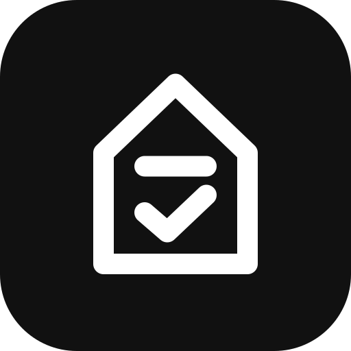
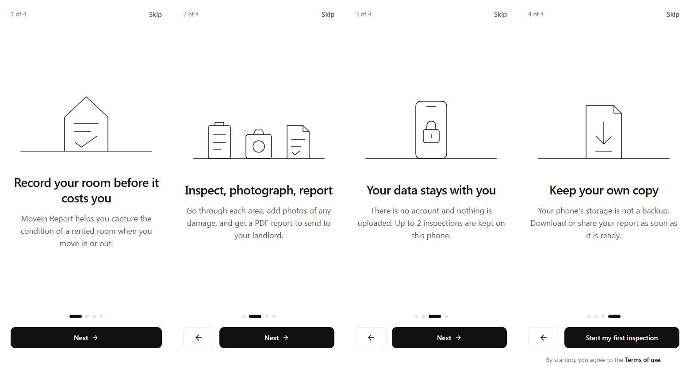

<p align="center">
  
</p>

<h1 align="center">MoveIn Report</h1>

<p align="center">
  Record the condition of a rented room, with photos, and export a PDF report.<br>
  No account. Nothing uploaded. Everything stays on your phone.
</p>

---

## The problem

Tenants lose deposits over damage that was already there when they moved in, because
they have no record of it. MoveIn Report walks a tenant through their room area by
area and turns what they record into a report they can send to their landlord on day one.

## What it does

- **Guided inspection** in seven steps, with a checklist built for the type of
  accommodation: single room, ensuite, shared, or bachelor.
- **Photos and defects** for every area. Photos are resized on the device before
  they are stored.
- **Meter readings** for electricity, water and other meters.
- **PDF report** generated on the device, ready to download or share.
- **Private by design.** Inspections live in the browser's own storage. There is
  no server database and no sign-in.
- **Autosave.** Every change is saved as you go, so you can close the app and
  continue later.
- **First-visit onboarding** that explains the app in four screens.

<p align="center">
  
</p>

## Built for phones

Most people will use this standing in a room with a phone in one hand, so the
interface is designed around that:

- Every button and control is at least 48px tall.
- Back and Continue sit in a bar fixed to the bottom of the screen, in thumb reach.
- Delete actions are solid red and set apart from the controls used most.
- Animations respect the device's reduced-motion setting.

## Tech stack

| Area | Choice |
| --- | --- |
| Framework | React 19 with TanStack Start and TanStack Router (file-based routes) |
| Language | TypeScript, strict mode |
| Styling | Tailwind CSS 4, with a small monochrome design system in `src/styles.css` |
| Storage | IndexedDB, through a thin repository layer in `src/db` |
| PDF | jsPDF, loaded only when a report is generated |
| Validation | Zod |
| Build and tests | Vite and Vitest |

## Getting started

You need [Node.js](https://nodejs.org) 22 and [Bun](https://bun.sh).

```sh
git clone https://github.com/<your-username>/movein-report.git
cd movein-report
bun install
bun run dev
```

The app opens at `http://localhost:8080` (or the next free port).

> **Note:** install with Bun, not `npm install`. The project pins its dependencies
> in `bun.lock`, and npm 11 crashes while resolving them.
>
> No Bun installed? Run `npx bun@latest install` once, then use `npm run dev` and
> the other scripts through npm.

### Scripts

| Command | What it does |
| --- | --- |
| `bun run dev` | Start the development server |
| `bun run build` | Build for production |
| `bun run preview` | Preview the production build |
| `bun run test` | Run the tests |
| `bun run lint` | Lint the code |
| `bun run format` | Format the code with Prettier |

## Project structure

```
src/
├── routes/                  Pages: home, inspection wizard, how it works, privacy, terms
├── features/
│   ├── inspection/          Checklists, validation, types and the wizard steps
│   └── onboarding/          First-visit intro
├── components/
│   ├── illustrations/       Logo and line drawings (SVG, drawn in code)
│   ├── layout/              Header, shared button styles
│   └── ui/                  Base UI components
├── db/                      IndexedDB access and the inspection repository
├── services/                PDF generation, image resizing, sharing
└── hooks/                   Loading and autosaving an inspection
```

## Privacy

Inspections and photos are stored only in the browser on the user's device, and the
report is generated there too. Nothing leaves the device unless the user downloads or
shares the report. The in-app Privacy and Terms pages explain this in full.

## Licence

© 2026 MoveIn Report. All rights reserved.

The source is published for reference. The name, logo and illustrations are original
work for this project and may not be reused without permission.
